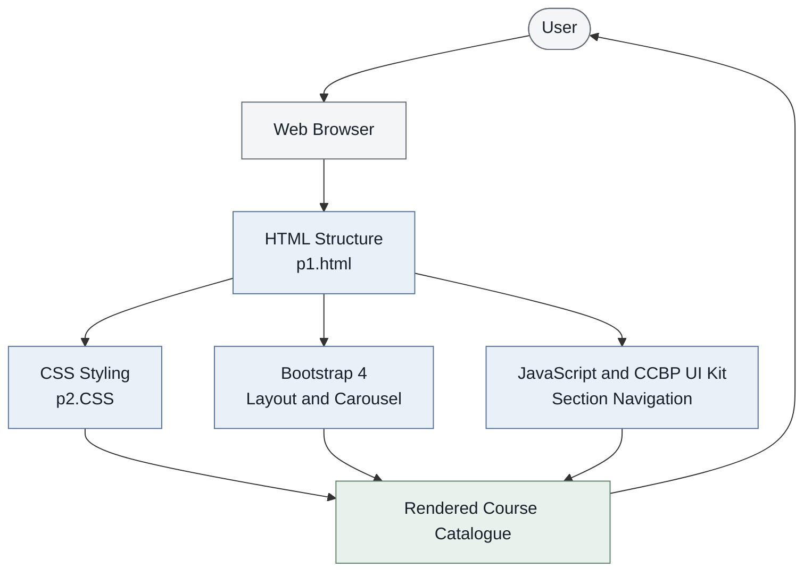

**Framework:** Bootstrap 4.5.2  
**Languages:** HTML5, CSS3, JavaScript  
**Frontend dependencies:** jQuery, Popper.js, CCBP UI Kit  
**Application type:** Front-end educational course catalogue  
**Backend / Database:** Not included in the supplied project

# Simple Learning Platform — Course Catalogue

## 1. Project Overview

The **Simple Learning Platform — Course Catalogue** is a front-end web application that organizes learning topics into four subject areas: **Technology, Science, Healthcare, and Business**.

The home screen presents each subject as a selectable card. Selecting a card opens the corresponding subject section, where users can browse an image carousel and review a list of related topics. A **Back** button returns users to the main category screen.

The project demonstrates core front-end development concepts: HTML for page structure, CSS for presentation, Bootstrap for layout and carousel components, and JavaScript-driven interactions for navigation.

## 2. Problem Statement

A catalogue covering several disciplines needs a clear and consistent way to group topics and help users browse them. This project demonstrates a category-based interface that presents subject areas and example topics in a straightforward visual structure.

## 3. Project Objectives

- Organize topics into distinct subject categories.
- Provide a clear landing page with selectable category cards.
- Display subject-related images using carousels.
- Present example topics for each category.
- Enable navigation between the landing page and category sections.
- Apply front-end layout, styling, and interaction techniques.

## 4. Key Features

### Subject categories
Users can select Technology, Science, Healthcare, or Business from the landing page.

### Image carousels
Each subject section includes a Bootstrap carousel with slide indicators and previous/next controls.

### Topic lists
Each category displays example topics related to its subject area.

### Section navigation
Category selection opens the associated section. The Back button returns to the category landing page.

### Consistent interface styling
Custom CSS defines the page background, cards, typography, spacing, and buttons. Bootstrap classes support layout and carousel presentation.

## 5. Technology Stack

| Technology | Purpose |
|---|---|
| HTML5 | Defines the page structure, category cards, topic lists, buttons, and carousel markup |
| CSS3 | Controls colors, typography, spacing, dimensions, and other visual styles |
| Bootstrap 4.5.2 | Provides layout utilities and carousel components |
| JavaScript | Supports interactive section navigation and carousel behavior |
| jQuery and Popper.js | Provide dependencies used by Bootstrap 4 JavaScript components |
| CCBP UI Kit | Included by the page for the supplied `display(...)` navigation behavior |

**Implementation scope:** The supplied files describe a client-side interface. They do not show a server-side framework, authentication, course enrollment, API integration, or a database. These should not be presented as implemented features unless they are added separately.

## 6. System Architecture

The diagram below represents the front-end structure shown in the supplied files. It does not imply a backend or database.



### Architecture explanation

1. The user opens the HTML page in a web browser.
2. The browser reads the page markup and loads the linked stylesheet and JavaScript dependencies.
3. HTML defines the category cards, subject sections, image carousels, topic lists, and navigation controls.
4. CSS and Bootstrap determine the page layout and visual presentation.
5. JavaScript-driven interactions display the selected category or return the user to the landing page.
6. The browser renders the resulting interface. The supplied project does not show server-side data processing.

## 7. Application Flowcharts

### A. Main user journey


### B. Category navigation logic


### Flowchart interpretation

- Each branch represents one of the four available categories.
- Carousel controls change the visible slide within the selected subject section.
- The Back button returns the user to the category landing page.
- The diagrams describe the behavior represented by the supplied HTML. They do not include login, enrollment, payments, APIs, or database operations.

## 8. Subject Categories and Example Topics

| Category | Example topics displayed |
|---|---|
| Technology | Artificial Intelligence, Data Science, Machine Learning, Internet of Things, Blockchain, Virtual Reality, Robotic Process Automation |
| Science | Biology, Zoology, Cardiology, Chemistry, Biochemistry, Nanoscience, Astronomy |
| Healthcare | Infrastructure Management, Latest in Healthcare, Pharmaceuticals, COVID-19 |
| Business | Business Models, 21st Century Business Skills, Traditional Business Approaches, Startup Fundamentals |

These are topic labels shown by the interface. The supplied files do not demonstrate full lessons, assessments, or enrollment functionality.

## 9. Project Structure

```text
Simple-Learning-Platform/
├── p1.html       # Main page structure and category sections
├── p2.CSS        # Custom visual styling
└── README.md     # Project documentation and flowcharts
```

Keep `p1.html` and `p2.CSS` in the same directory unless the stylesheet path in the HTML file is changed.

## 10. How to Run the Project

1. Download or clone the repository.
2. Keep `p1.html` and `p2.CSS` in the same folder.
3. Ensure an internet connection is available because Bootstrap, jQuery, Popper.js, fonts, images, and the CCBP UI Kit are referenced through external URLs.
4. Open `p1.html` in a modern web browser.
5. Select a category, browse the carousel, review the topics, and select **Back** to return to the landing page.

No Python installation, server setup, or database configuration is required for the front-end behavior represented in these files.

## 11. Learning Outcomes

This project provides practice in:

- Structuring a multi-section interface with HTML.
- Applying visual styles with CSS.
- Using Bootstrap layout utilities and carousel components.
- Connecting user actions to section navigation.
- Grouping related content into consistent interface patterns.
- Documenting application structure and behavior with Mermaid diagrams.

## 12. Current Scope and Future Improvements

The supplied version is a front-end demonstration. Potential improvements include:

- Improve layout behavior on smaller screens.
- Add meaningful `alt` text to content images.
- Verify that each carousel has unique IDs and correctly associated controls.
- Replace inline `onclick` attributes with organized JavaScript event listeners.
- Improve keyboard navigation and accessibility.
- Store topic content in structured data to reduce repeated markup.
- Add a backend, database, accounts, or enrollment only if these are required for a future version.

## 13. Privacy and Security

This documentation describes the visible application behavior and does not include credentials, tokens, or private account details.

Before making the repository public, review the project files and Git history for private information. Also review external scripts, assets, and dependencies referenced by the page.

---

**Project summary:** A front-end learning catalogue built with HTML5, CSS3, Bootstrap 4, and JavaScript. It demonstrates category-based browsing, image carousels, topic organization, and navigation between subject sections.
