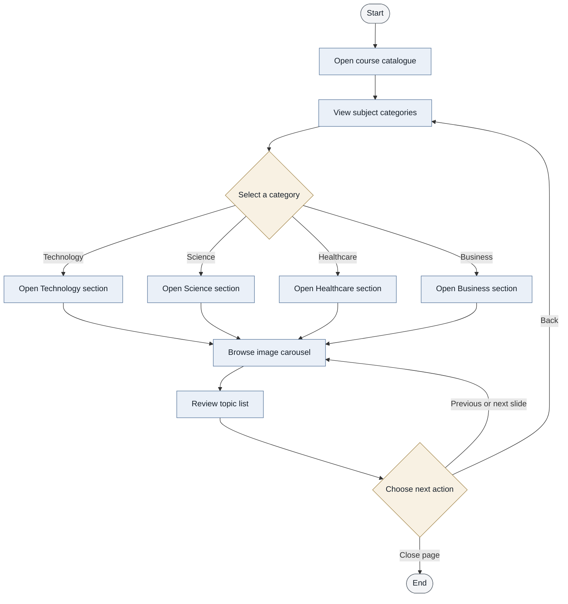
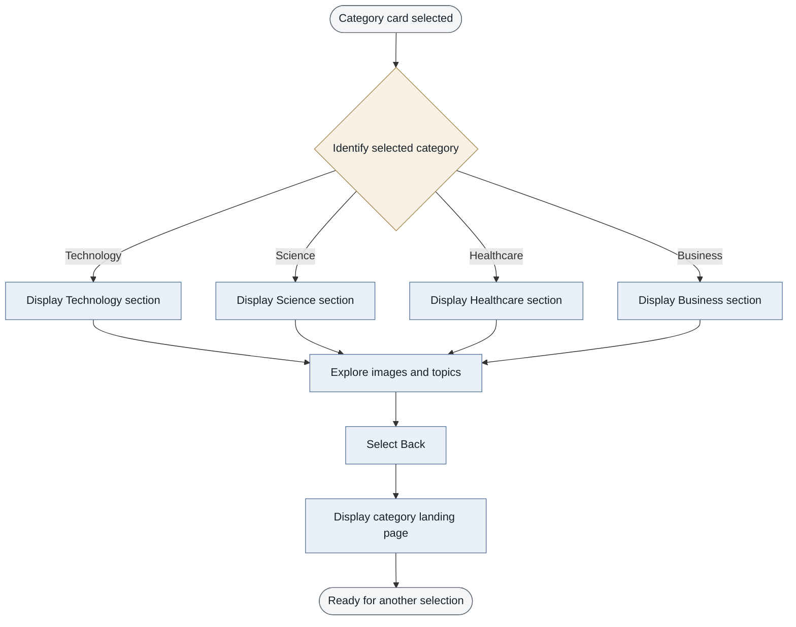

**Framework:** Bootstrap 4.5.2  
**Languages:** HTML5, CSS3, JavaScript  
**Frontend dependencies:** jQuery, Popper.js, CCBP UI Kit  
**Application type:** Front-end educational course catalogue  
**Backend / Database:** Not included in the supplied project

# Simple Learning Platform — Course Catalogue

A responsive, category-based learning catalogue that presents example topics across Technology, Science, Healthcare, and Business. The interface uses selectable category cards, subject-specific image carousels, topic lists, and simple section navigation.


---

## 1. Project Overview

The **Simple Learning Platform — Course Catalogue** is a client-side web application designed to make subject browsing clear and straightforward.

The landing page displays four subject categories as selectable cards. Selecting a category opens its content section, where users can browse an image carousel and review related topic labels. A **Back** control returns users to the category landing page.

The project demonstrates the role of HTML in page structure, CSS in visual presentation, Bootstrap in layout and carousel components, and JavaScript-driven interactions in navigation.

## 2. Problem Statement

A catalogue covering multiple disciplines needs a consistent way to group topics and help users navigate between them. This project addresses that interface-level need by organizing example topics into subject categories and presenting them through a simple, structured browsing experience.

## 3. Objectives

- Organize example learning topics into four subject categories.
- Provide a clear landing page with selectable category cards.
- Display subject-related images through carousels.
- Present topic lists for each category.
- Enable navigation between the landing page and category sections.
- Apply front-end layout, styling, and interaction concepts.

## 4. Features

| Feature | Description |
|---|---|
| Category selection | Opens the selected Technology, Science, Healthcare, or Business section |
| Image carousels | Displays subject-related images with carousel controls |
| Topic lists | Presents example topics within each category |
| Section navigation | Allows users to return to the landing page using the Back control |
| Custom styling | Applies consistent colors, typography, spacing, cards, and button styles |

## 5. Technology Stack

| Technology | Role |
|---|---|
| HTML5 | Defines page structure, category cards, content sections, topic lists, and carousel markup |
| CSS3 | Controls colors, typography, spacing, dimensions, and visual styling |
| Bootstrap 4.5.2 | Provides layout utilities and carousel components |
| JavaScript | Supports section navigation and interactive behavior |
| jQuery and Popper.js | Provide dependencies used by Bootstrap 4 JavaScript components |
| CCBP UI Kit | Included for the supplied `display(...)` navigation behavior |

**Scope note:** The supplied files show a front-end interface only. They do not demonstrate a server-side framework, authentication, API integration, course enrollment, payments, or database operations. These capabilities should not be described as implemented features unless they are added separately.

## 6. System Architecture

The diagram represents the front-end structure of the supplied project. It does not imply a backend or database.


### Architecture walkthrough

1. The user opens `p1.html` in a web browser.
2. The browser reads the HTML markup and loads the linked stylesheet and JavaScript dependencies.
3. HTML defines the category cards, subject sections, image carousels, topic lists, and navigation controls.
4. CSS and Bootstrap determine the layout and visual presentation.
5. JavaScript-driven interactions display the selected category or return the user to the landing page.
6. The browser renders the interface. The supplied project does not show server-side data processing.

## 7. Application Flowcharts

### 7.1 Main user journey



### 7.2 Category navigation logic



### Flowchart notes

- Each branch represents one of the four available categories.
- Carousel controls change the visible slide within the selected subject section.
- The Back control returns the user to the category landing page.
- The diagrams describe the behavior represented by the supplied HTML; they do not include login, enrollment, payments, API calls, or database operations.

## 8. Subject Categories

| Category | Example topics displayed |
|---|---|
| Technology | Artificial Intelligence, Data Science, Machine Learning, Internet of Things, Blockchain, Virtual Reality, Robotic Process Automation |
| Science | Biology, Zoology, Cardiology, Chemistry, Biochemistry, Nanoscience, Astronomy |
| Healthcare | Infrastructure Management, Latest in Healthcare, Pharmaceuticals, COVID-19 |
| Business | Business Models, 21st Century Business Skills, Traditional Business Approaches, Startup Fundamentals |

These are topic labels displayed by the interface. The supplied files do not demonstrate full lessons, assessments, or enrollment functionality.

## 9. Project Structure

```text
Simple-Learning-Platform/
├── p1.html       # Main page structure and category sections
├── p2.CSS        # Custom visual styling
└── README.md     # Project documentation
```

Keep `p1.html` and `p2.CSS` in the same directory unless the stylesheet path in the HTML file is changed.

## 10. Run Locally

1. Clone or download the repository.
2. Keep `p1.html` and `p2.CSS` in the same folder.
3. Ensure an internet connection is available because Bootstrap, jQuery, Popper.js, fonts, images, and the CCBP UI Kit are referenced through external URLs.
4. Open `p1.html` in a modern web browser.
5. Select a category, browse the carousel, review the topics, and select **Back** to return to the landing page.

No Python installation, server setup, or database configuration is required for the front-end behavior represented in these files.

## 11. Learning Outcomes

This project provides practice in:

- Structuring a multi-section interface with HTML.
- Applying visual styles with CSS.
- Using Bootstrap layout utilities and carousel components.
- Connecting user actions to section navigation.
- Organizing related content into consistent interface patterns.
- Documenting application structure and behavior with Mermaid diagrams.

## 12. Potential Improvements

The supplied version is a front-end demonstration. Potential improvements include:

- Improve layout behavior on smaller screens.
- Add meaningful `alt` text to content images.
- Verify that each carousel has unique IDs and correctly associated controls.
- Replace inline `onclick` attributes with organized JavaScript event listeners.
- Improve keyboard navigation and accessibility.
- Store topic content in structured data to reduce repeated markup.
- Add a backend, database, user accounts, or enrollment only if required for a future version.

## 13. Privacy and Security

This README describes the visible application behavior and does not include credentials, tokens, or private account details.

Before publishing the repository publicly, review all project files and Git history for private information. Review external scripts, assets, and dependencies referenced by the page as well.

---

**Summary:** A front-end learning catalogue built with HTML5, CSS3, Bootstrap 4, and JavaScript. It demonstrates category-based browsing, image carousels, topic organization, and navigation between subject sections.
